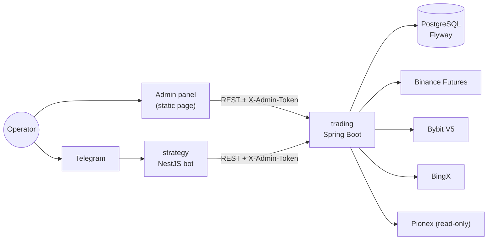

# sonar-v2

[](https://github.com/Big-Lapa/sonar-v2/actions/workflows/ci.yml)

A self-hosted console for trading crypto perpetual futures on several exchanges at once.
An operator opens a position from a web panel, the platform sizes it from the account's risk
budget, runs it through a chain of risk rules, places the entry with TP/SL attached on every
selected account, and then keeps watching: stops must exist, daily loss and drawdown limits
pause trading, and a Telegram bot works as a remote control.

It is a pet project built to explore the parts of trading software that are easy to get wrong:
sizing, idempotent order flow, protective stops, per-account credentials and failure handling on
flaky exchange APIs. It is not a trading strategy and it does not decide what to trade.

> **Not financial advice.** The code trades on real exchanges. Try it on demo/testnet accounts
> first; real money is at your own risk.

## How it fits together



| Service | Stack | Role |
| --- | --- | --- |
| [`trading`](trading) | Java 21, Spring Boot 3.5, JPA, Flyway, Resilience4j | Source of truth: accounts, sizing, risk rules, order execution, 1-minute poller, REST API and the admin panel |
| [`strategy`](strategy) | Node 22, NestJS 11, TypeScript | Telegram bot: balances, positions, stop moves, `/closeall`, notification relay. Answers only allow-listed chats; destructive commands need a PIN with a lockout |
| [`tv-bridge`](tv-bridge) | Node, Express, Chrome DevTools Protocol | Experimental host-side bridge to TradingView Desktop (levels drawing, screenshots). Not used by the running stack |

Exchanges: Binance, Bybit and BingX are fully wired (reader and execution adapter). Pionex is
read-only because its futures API exposes no TP/SL, so the platform refuses to pretend it can
protect a position there.

## Engineering notes

The decisions that took the most thought, with pointers into the code.

- **Risk rules as a prioritized chain.**
  [`DefaultRiskEngine`](trading/src/main/java/com/sonar/trading/risk/DefaultRiskEngine.java) runs
  [seven rules](trading/src/main/java/com/sonar/trading/risk/rules) in priority order. Risk-reducing
  actions (close, reduce) always pass, so a paused account can still flatten. Auto-pause is
  persisted, so a restart does not silently re-enable trading; a daily-loss pause clears at the
  UTC rollover, a drawdown pause only by a human. Portfolio risk counts the risk *planned* at open,
  not mark-to-market, so a favourable move never frees headroom for more exposure.
- **Idempotent confirm without a long transaction.** A proposal is claimed with one atomic update
  in a separate bean ([`ProposalClaimer`](trading/src/main/java/com/sonar/trading/execution/ProposalClaimer.java)),
  because the confirm path holds exchange HTTP calls and polling sleeps that must not sit inside a
  DB transaction. A second layer keyed by `(proposal, account)` protects the multi-account fan-out
  ([`SignalInboxEntity`](trading/src/main/java/com/sonar/trading/domain/entity/SignalInboxEntity.java)).
  A repeated tap returns the original report instead of a second order.
- **A position never sits without a stop.**
  [`StopGuard`](trading/src/main/java/com/sonar/trading/execution/StopGuard.java) checks right
  after an entry fills and again every minute. Recognising a stop is venue-specific (BingX: a
  separate conditional order, Bybit: a position-level field), so each adapter classifies it and
  the guard only distinguishes "no stop" from "could not read".
- **Resilience that treats exits differently from entries.**
  [`ResilientExecutionGateway`](trading/src/main/java/com/sonar/trading/execution/gateway/ResilientExecutionGateway.java)
  wraps every venue with a circuit breaker, rate limiter and retry. The breaker only gates new
  entries; closes bypass it.
- **Credentials per account, not per venue.** The same exchange can host a demo and a production
  account on different domains, so adapters are looked up by account id
  ([`ExecutionAdapterRegistry`](trading/src/main/java/com/sonar/trading/execution/adapter/ExecutionAdapterRegistry.java)).
  The service refuses to start if an account has keys but no base URL, or two accounts share an
  API key, so a production account cannot inherit a demo domain.
- **Risk-based sizing.** Quantity comes from the account's risk percent and the stop distance,
  then is clamped to the exchange's step size, minimum quantity and minimum notional
  ([`RiskBasedPositionSizer`](trading/src/main/java/com/sonar/trading/sizing/RiskBasedPositionSizer.java),
  [`QuantityNormalizer`](trading/src/main/java/com/sonar/trading/sizing/QuantityNormalizer.java)).

## Run it

Requirements: Docker with Compose.

```bash
cp .env.example .env
# set POSTGRES_PASSWORD and ADMIN_TOKEN at minimum
docker compose up --build
```

- Admin panel: <http://localhost:8080/admin/index.html> (enter `ADMIN_TOKEN` when asked)
- Health: `http://localhost:8080/actuator/health` (trading), `http://localhost:3000/health` (strategy)
- All ports are bound to `127.0.0.1`.

Accounts live in `.env` as `TRADING_ACCOUNTS_N_*`. An account with blank keys stays visible in the
panel but unconnected, so you can start with a single demo account (BingX VST, Binance testnet or
Bybit demo). Leave `TELEGRAM_BOT_TOKEN` empty to run without the bot.

## Tests

```bash
cd trading && mvn verify          # 239 tests: risk rules, sizing, adapters, parsers, i18n
cd strategy && npm ci && npm test # 60 tests: bot, access guard, i18n
```

Tests mock the exchanges; nothing in CI touches a real API. CI runs both suites and
`docker compose build` on every pull request. The panel, the bot and the backend notification
codes are available in English and Russian, and the tests fail when a dictionary drifts from the
codes it renders.

## Known limitations and roadmap

- A position adopted from the exchange (opened outside the platform) gets `openedAt` = the moment
  the poller found it, so PnL accrued before that is missing from its close notification. It is
  marked in [`MinutePoller`](trading/src/main/java/com/sonar/trading/execution/MinutePoller.java)
  and deferred.
- The Telegram PIN lockout is in memory and resets when the `strategy` container restarts, hence
  the advice to use a PIN longer than four digits.
- The LLM candidate-search pipeline (klines, levels, universe filters, Anthropic API) is still in
  `strategy/src` but not wired into the Nest module, so the running service makes no model calls.
- Next: a transactional outbox for order commands, automatic reconciliation of local state with
  the exchange, and an execution adapter for Pionex if its API gains TP/SL.

## License

Copyright (c) 2026 Andrei Lapin. All rights reserved. The source is published for review only;
see [LICENSE](LICENSE).
